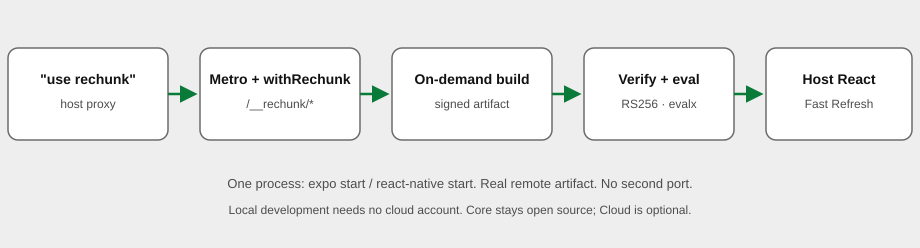
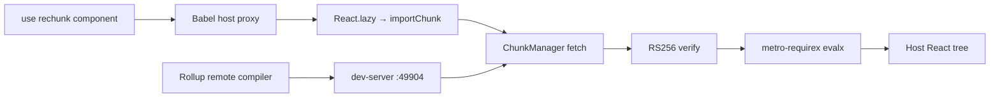

<div align="center">
  <picture>
    <source media="(prefers-color-scheme: dark)" srcset="./.github/assets/readme/logo-dark.svg">
    
  </picture>

  <h1>ReChunk</h1>

  <p><strong>Deploy a React Native component independently — without changing how you build your app.</strong></p>

  <p>
    <a href="https://www.npmjs.com/package/@rechunk/core"></a>
    <a href="LICENSE.md"></a>
    
    
  </p>

  <p>
    <a href="https://rechunk.xyz">Website</a>
    ·
    <a href="https://rechunk.xyz/docs/">Docs</a>
    ·
    <a href="https://discord.gg/xFhuxjwhss">Discord</a>
    ·
    <a href="https://github.com/crherman7/metro-requirex">metro-requirex</a>
  </p>
</div>

<br>

**ReChunk** is a component-level delivery layer for React Native developers. Mark a file with `"use rechunk"`, keep Metro and Expo as they are, and ship that one component as a signed remote artifact — without turning your app into a federation host.

> **Status:** public beta on npm (`@rechunk/*` **0.3.0**). Local development currently uses a companion `rechunk dev-server` on port **49904**. Metro-integrated development (no second process) and remote Fast Refresh are next milestones — see [Roadmap](#roadmap).

---

## The idea

App-level OTA (Expo Updates and similar) replaces a whole JS bundle. Module Federation can distribute remotes, but usually asks you to restructure hosts, remotes, and shared scopes.

ReChunk’s bet is narrower: **one ordinary React Native component**, independently buildable and deliverable, with almost no surface area in source:

```tsx
"use rechunk";

export default function CheckoutCard() {
  return <CheckoutSummary />;
}
```

That file still uses normal hooks, context, styles, and host native modules. At runtime it executes **inside the host JS runtime** after download and RS256 verification — not in a separate sandbox.

---

## Why teams reach for it

| You want… | ReChunk’s approach |
| --- | --- |
| Ship UI without a full store release | Publish a signed component artifact, not a whole app bundle |
| Keep Metro / Expo | Host bundler stays Metro; no Re.Pack / Rspack migration required |
| Tiny developer API | File directive + default export; Babel swaps in a `React.lazy` proxy |
| Integrity on the wire | Artifacts are signed (RS256) and verified before evaluation |
| Host capabilities | Shared React runtime via [`metro-requirex`](https://github.com/crherman7/metro-requirex) |

**Not a claim we make:** signing is not a sandbox. Remote code runs with the same privileges as your app JS. Treat publishers and release policy as the real security boundary.

**When to use something else:** if you only need whole-app OTA, Expo EAS Update is simpler. If you are building a full microfrontend platform with many remotes and shared scopes, Module Federation / Re.Pack may fit better.

---

## How it works today

<p align="center">
  <picture>
    <source media="(prefers-color-scheme: dark)" srcset="./.github/assets/readme/architecture-dark.svg">
    
  </picture>
</p>

1. **Babel** sees `"use rechunk"`, requires a single default export, strips the implementation from the host graph, and inserts `React.lazy(() => importChunk(...))`.
2. **Runtime** (`@rechunk/core`) fetches the artifact, verifies the signature, evaluates with `evalx`, and resolves host modules through Metro.
3. **Dev** serves on-demand Rollup builds from `rechunk dev-server` (default `http://localhost:49904`).
4. **Prod** publishes immutable chunks to your configured host (`rechunk publish`).



---

## Quick start

**Requires Node ≥ 20.14** (see root `package.json` `engines`).

### 1. Install

```bash
npm install @rechunk/core
npm install -D @rechunk/cli @rechunk/babel-plugin @rechunk/metro-config

# or
pnpm add @rechunk/core
pnpm add -D @rechunk/cli @rechunk/babel-plugin @rechunk/metro-config
```

### 2. Initialize a project

Creates `.rechunkrc.json` against a ReChunk host (basic auth today — expected to evolve):

```bash
npx rechunk init \
  --host https://your-rechunk-host.example/api/v1 \
  --username <user> \
  --password <password>
```

Hosted beta endpoint (credentials rotate; treat as demo only):

```bash
npx rechunk init \
  --host https://rechunk.xyz/api/v1 \
  --username admin \
  --password password123
```

### 3. Wire Babel + Metro

**Expo** (matches `apps/expo` in this repo):

```js
// babel.config.js
const {withBabelPresetExpoOptions} = require('@rechunk/babel-plugin');

module.exports = api => ({
  presets: [['babel-preset-expo', withBabelPresetExpoOptions(api)]],
  plugins: [['@rechunk/babel-plugin']],
});
```

```js
// metro.config.js
const {cacheVersion} = require('@rechunk/metro-config');
const {getDefaultConfig} = require('expo/metro-config');
const {withMetroRequirexConfig} = require('@metro-requirex/metro-config');

const config = getDefaultConfig(__dirname);
config.cacheVersion = cacheVersion;

module.exports = withMetroRequirexConfig(config, {eager: true});
```

**Bare React Native** — use `withReactNativeBabelPresetOptions` from `@rechunk/babel-plugin` (see `apps/react-native/babel.config.js`).

### 4. Mark a component

```tsx
"use rechunk";

import React, {useState} from 'react';
import {Pressable, Text} from 'react-native';

export default function PromoBanner() {
  const [n, setN] = useState(0);
  return (
    <Pressable onPress={() => setN(n + 1)}>
      <Text>Shipped remotely · taps {n}</Text>
    </Pressable>
  );
}
```

Render it behind `Suspense` like any other lazy component. On first mount the host proxy calls `importChunk`, downloads the signed artifact, verifies it, and mounts the remote default export in the same React tree.

### 5. Develop and publish

```bash
# Terminal A — on-demand remote compiler (required today)
npx rechunk dev-server

# Terminal B — your usual Metro / Expo process
RECHUNK_ENVIRONMENT=dev npx expo start
```

```bash
# Production publish (interactive component picker)
npx rechunk publish

# Optional project management UI
npx rechunk manage
```

| `RECHUNK_ENVIRONMENT` | Behavior |
| --- | --- |
| `dev` | Load from the local ReChunk dev server |
| `prod` | Load from the configured remote host |
| `offline` | Offline / fixture path for local testing |

Example apps in-repo: [`apps/expo`](./apps/expo) and [`apps/react-native`](./apps/react-native) (`ios:dev` / `android:dev` scripts run `rechunk dev-server` alongside Metro).

---

## Packages

| Package | Role |
| --- | --- |
| [`@rechunk/core`](./packages/core) | Runtime: `importChunk`, configuration, events |
| [`@rechunk/babel-plugin`](./packages/babel-plugin) | `"use rechunk"` → host proxy |
| [`@rechunk/cli`](./packages/cli) | `init`, `dev-server`, `publish`, `manage` |
| [`@rechunk/metro-config`](./packages/metro-config) | Metro `cacheVersion` helper |
| [`@rechunk/rollup-preset`](./packages/rollup-preset) | Remote component bundling |
| [`@rechunk/api-client`](./packages/api-client) | Typed HTTP client for the control plane |

Companion: [`metro-requirex`](https://github.com/crherman7/metro-requirex) — deterministic host module IDs + `evalx`.

---

## Roadmap

Direction from the working architecture blueprint. Labels match implementation reality:

| Milestone | Intent | State |
| --- | --- | --- |
| **One Metro server** | Mount ReChunk compile/serve on Metro’s HTTP listener; retire `:49904` for the default workflow | Decided — not shipped |
| **Remote Fast Refresh** | Rebuild the real remote artifact and preserve hook state via host React Refresh | Proposed — unproven on RN/Hermes |
| **Host resolver** | Abstract hashed Metro IDs vs generated host registry; drop brittle eager hacks | Open — benchmark both |
| **Manifests + compatibility** | Immutable digests, host build descriptors, block incompatible natives before eval | Planned |
| **ReChunk Cloud** | Cloudflare Workers / D1 / R2 delivery, component-first dashboard, rollouts | Optional managed layer |

Non-goals for early releases: forcing Re.Pack, sandboxing third-party plugins, or a customer-facing AI agent.

---

## Comparison

| | ReChunk | Expo EAS Update | Module Federation / Re.Pack |
| --- | --- | --- | --- |
| Unit of delivery | Component artifact | App JS bundle / update | Remote modules / remotes |
| Host bundler | Metro (kept) | Metro | Often Re.Pack / custom |
| Opt-in API | `"use rechunk"` file directive | Update channels / runtime | Federation config |
| Local cloud account | Not required for Core | Expo account for EAS | Varies |

---

## Contributing

Development happens on the `develop` branch. See [CONTRIBUTING.md](./CONTRIBUTING.md), [CODE_OF_CONDUCT.md](./CODE_OF_CONDUCT.md), and [SECURITY.md](./SECURITY.md).

```bash
pnpm install
pnpm build
```

---

## License

[MIT](./LICENSE.md) © Christopher Herman
