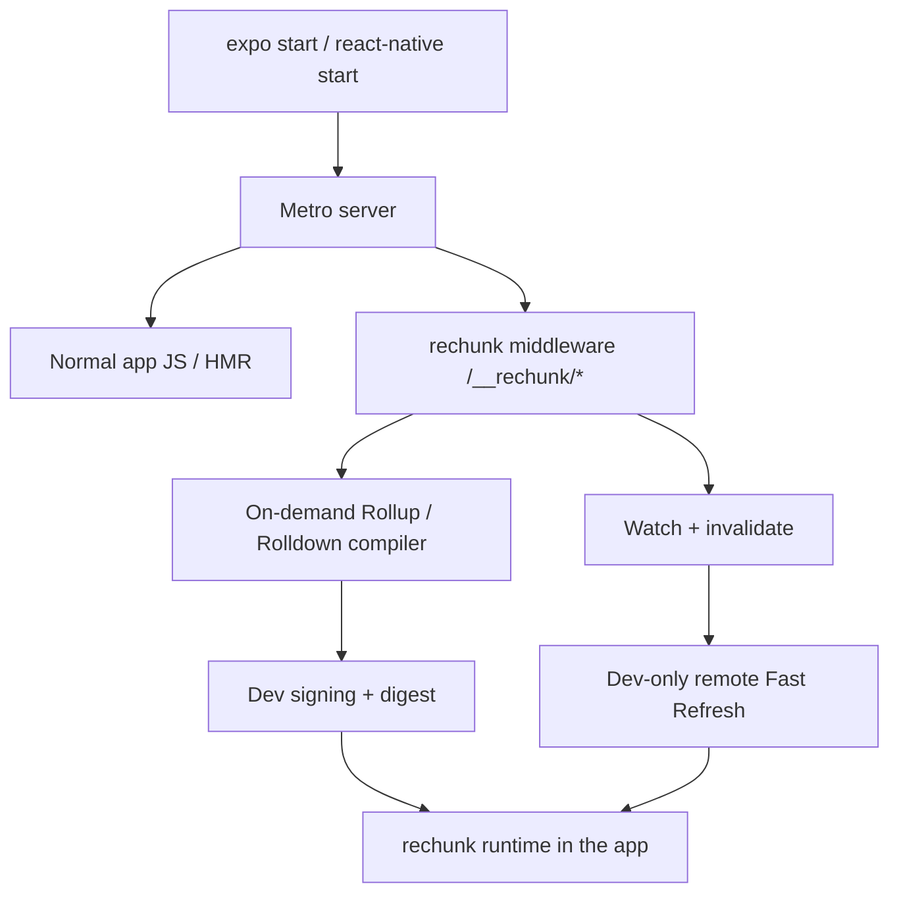

<div align="center">
  <picture>
    <source media="(prefers-color-scheme: dark)" srcset="./.github/assets/readme/logo-dark.svg">
    
  </picture>

  <h1>rechunk</h1>

  <p><strong>Independently build, develop, deliver, and manage ordinary React Native components — without replacing Metro or restructuring the app.</strong></p>

  <p>
    <a href="https://www.npmjs.com/package/@rechunk/core"></a>
    <a href="LICENSE.md"></a>
    
    
  </p>

  <p>
    <a href="https://rechunk.xyz">Website</a>
    ·
    <a href="https://rechunk.xyz/docs/">Docs</a>
    ·
    <a href="https://discord.gg/xFhuxjwhss">Discord</a>
    ·
    <a href="https://github.com/crherman7/metro-requirex">metro-requirex</a>
  </p>
</div>

<br>

**rechunk** is a component-level delivery platform for React Native. Mark a file with `"use rechunk"`, keep your usual Metro / Expo / React Native CLI, and ship that one component as a **real signed remote artifact** — not a whole-app OTA bundle, and not a Module Federation remotes project.

> **Defining developer experience**
>
> 1. Add `"use rechunk";` to a default-export component  
> 2. Run `npx expo start` or `npx react-native start`  
> 3. The on-demand rechunk artifact loads (and refreshes) through **Metro’s own server**  
>
> No second rechunk process. No second port. No cloud account for local development.

> **Status:** npm packages are public beta (`@rechunk/*` **0.3.0**). The shipped toolchain still uses a companion `rechunk dev-server` (`:49904`) while we land Metro middleware. This README describes the **target product** from the architecture blueprint; [Implementation status](#implementation-status) separates what exists today from what is decided next.

---

## Product pillars

| Pillar | Outcome |
| --- | --- |
| **Zero-friction integration** | Keep Metro, Expo, and React Native CLIs; one-time init + a file directive |
| **Reliable remote execution** | Download, validate, verify, resolve, execute, and cache a real remote artifact |
| **Production-safe delivery** | Host-build compatibility, immutable versions, rollouts, fallback, rollback |
| **rechunk Cloud** *(optional)* | Component-first registry, release UI, and observability on Cloudflare |

**Nonnegotiables:** Metro stays the host bundler. `"use rechunk"` stays the opt-in API. Development runs a **real** rechunk-bundled artifact (no silent Metro source bypass). Core stays open source; Cloud is optional. Signing authenticates artifacts — it is **not** a sandbox.

---

## The API

```tsx
"use rechunk";

export default function CheckoutCard() {
  return <CheckoutSummary />;
}
```

Same hooks, context, styles, and host native modules. Execution stays inside the host JS runtime via [`metro-requirex`](https://github.com/crherman7/metro-requirex).

---

## Target architecture

<p align="center">
  <picture>
    <source media="(prefers-color-scheme: dark)" srcset="./.github/assets/readme/architecture-dark.svg">
    
  </picture>
</p>



**What “no extra server” means:** no second Node process, no mandatory `:49904`, no cloud round-trip for local compile. Compilation still costs CPU inside Metro — caching and scheduling matter.

---

## Quick start *(target)*

**Requires Node ≥ 20.14.**

### One-time setup

```bash
npx rechunk init
```

`init` detects Expo or bare RN, installs `@rechunk/*`, composes Metro instead of replacing it, wires the Babel directive, and sets sensible local defaults. Publishing credentials stay out of the embedded runtime config.

**Metro** *(target API — `withRechunk`)*:

```js
const {getDefaultConfig} = require('expo/metro-config');
const {withRechunk} = require('@rechunk/metro-config');

const config = getDefaultConfig(__dirname);
module.exports = withRechunk(config, {projectRoot: __dirname});
```

### Develop

```bash
npx expo start
# or
npx react-native start
```

Expected: the host proxy calls `importChunk`, Metro’s rechunk middleware builds and signs the remote artifact on demand, the runtime verifies and evaluates it, and the component renders in the normal React tree. Save the source → rebuild → **state-preserving remote Fast Refresh** (Phase 2 gate).

### Publish

```bash
npx rechunk publish
```

Builds and signs an **immutable** artifact with size, dependency, and compatibility metadata, then pushes to self-hosted storage or rechunk Cloud. Promotion / rollout is a separate, auditable step — not an implicit 100% ship.

---

## Core vs Cloud

| Capability | rechunk Core (OSS) | rechunk Cloud |
| --- | --- | --- |
| `"use rechunk"` + Babel proxy | Yes | Uses Core |
| Metro-integrated local development | Yes | Not required |
| On-demand remote compilation | Yes | Publish via CLI / CI |
| Runtime verify, cache, fallback | Yes | Uses Core |
| Self-hosted release resolution | Supported path | Managed API |
| Artifact CDN | Bring your own | R2 + Cloudflare CDN |
| Dashboard, rollouts, audit | Optional self-host | Managed |
| Hosted analytics | SDK hooks | Managed ingestion |

Local development never depends on a Cloudflare account.

---

## Compared to alternatives

| | rechunk | Expo EAS Update | Module Federation / Re.Pack |
| --- | --- | --- | --- |
| Unit of delivery | Component artifact | App JS update | Remotes / shared scopes |
| Host bundler | Metro kept | Metro | Often Re.Pack / custom |
| Opt-in | File directive | Update channels | Federation config |
| Local cloud account | Not required for Core | Expo account for EAS | Varies |

We do **not** claim “nobody else does remote RN code,” “first Metro remotes,” or “signed = sandboxed.”

**Use something else when:** whole-app OTA is enough (EAS Update), or you already want a full federation platform.

---

## Implementation status

| Area | Blueprint | Today (0.3.0 beta) |
| --- | --- | --- |
| `"use rechunk"` → `React.lazy` / `importChunk` | Decided | **Shipped** |
| Rollup remote compiler + RS256 verify | Decided | **Shipped** |
| Shared host React via metro-requirex | Decided | **Shipped** |
| Metro middleware (`withRechunk`, no `:49904`) | Decided | In progress — companion `rechunk dev-server` still required |
| State-preserving remote Fast Refresh | Proposed | Unproven on RN / Hermes |
| Host registry vs hashed Metro IDs | Open | Hashed IDs exist; registry / hybrid to benchmark |
| Manifests + native compatibility gating | Planned | Limited metadata today |
| rechunk Cloud (Workers / D1 / R2 / dashboard) | Selected direction | Product design / mocks — not shipped |

### Milestone order

0. **Baseline** — reproducible signed loads on iOS/Android + benchmarks  
1. **One Metro server** — middleware only; gate: `expo start` alone  
2. **Remote Fast Refresh** — Counter stays at `7` + stable `useRef` on Hermes  
3. **Host resolver hardening** — registry vs hash benchmarks; typed errors; immutable cache  
4. **Manifests + compatibility** — reject incompatible natives before eval  
5. **Cloud MVP** — publish, digest, canary rollout, pause/rollback  
6. **Analytics + paid workflows** — adoption/latency with honest denominators  

### Explicit non-goals (early releases)

- Forced Re.Pack / Rspack migration  
- Mandatory standalone rechunk HTTP process  
- Silent Metro-source bypass as the primary dev mode  
- Full sandbox / untrusted plugin marketplace  
- Customer-facing AI agent  
- Blanket “app-store compliant OTA” promises  

---

## Packages

| Package | Role |
| --- | --- |
| [`@rechunk/core`](./packages/core) | Runtime loader pipeline |
| [`@rechunk/babel-plugin`](./packages/babel-plugin) | Directive → host proxy |
| [`@rechunk/cli`](./packages/cli) | `init`, `dev-server` *(current)*, `publish`, `manage` |
| [`@rechunk/metro-config`](./packages/metro-config) | Evolving toward `withRechunk()` |
| [`@rechunk/rollup-preset`](./packages/rollup-preset) | Remote component bundling |
| [`@rechunk/api-client`](./packages/api-client) | Control-plane HTTP client |

Example apps: [`apps/expo`](./apps/expo), [`apps/react-native`](./apps/react-native).

### Current beta workflow *(until Phase 1)*

```bash
npx rechunk init --host <url> --username <user> --password <pass>
npx rechunk dev-server          # Terminal A — :49904 today
RECHUNK_ENVIRONMENT=dev npx expo start   # Terminal B
npx rechunk publish
```

---

## Contributing

Work lands on `develop`. See [CONTRIBUTING.md](./CONTRIBUTING.md), [CODE_OF_CONDUCT.md](./CODE_OF_CONDUCT.md), and [SECURITY.md](./SECURITY.md).

```bash
pnpm install
pnpm build
```

**Implementation priority:** Metro-integrated on-demand artifacts first, then remote Fast Refresh proofs, then compatibility/Cloud — not Cloud first.

---

## License

[MIT](./LICENSE.md) © Christopher Herman
